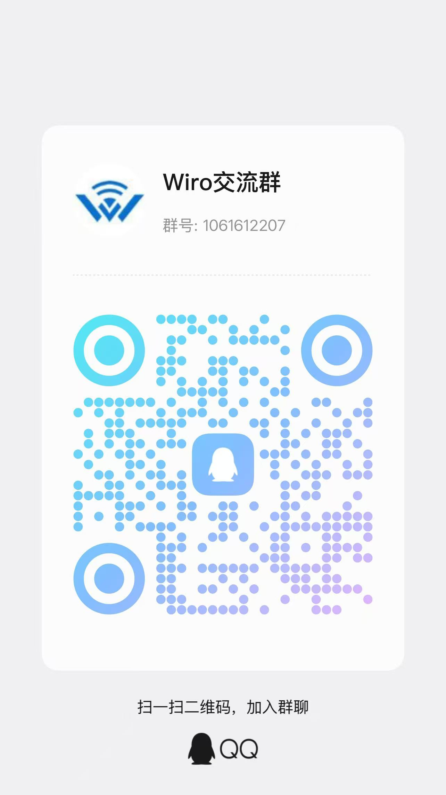

# XR1710G OpenWrt / iStoreOS Wi-Fi 7 Community Firmware

**Current release: [v2.02](https://github.com/orangeyoo/XR1710G-OpenWrt-iStoreOS-Community/releases/tag/v2.02)** · Updated: 2026-10-13 · This release ships the firmware together with an optional U-Boot update.

[](https://github.com/orangeyoo/XR1710G-OpenWrt-iStoreOS-Community/releases/latest)
[](https://github.com/orangeyoo/XR1710G-OpenWrt-iStoreOS-Community/releases/latest)
[](https://github.com/orangeyoo/XR1710G-OpenWrt-iStoreOS-Community)
[](https://github.com/orangeyoo/XR1710G-OpenWrt-iStoreOS-Community/forks)
[](https://github.com/orangeyoo/XR1710G-OpenWrt-iStoreOS-Community/issues)
[](https://github.com/orangeyoo/XR1710G-OpenWrt-iStoreOS-Community/commits/source-2.0)
[](ATTRIBUTION.md)
[](https://openwrt.org)
[](CHANGES-v1.md)
[](https://en.wikipedia.org/wiki/Wi-Fi_7)
[](https://www.airoha.com/)
[](https://github.com/YYH2913/openwrt)
[](https://www.docker.com/)
[](#community-and-support)

Unofficial community firmware for the **Gemtek XR1710G**: tri-band Wi-Fi 7, a dedicated 6GHz mesh backhaul, the iStore app shop and Docker — ready to flash.

**[Download v2.02](https://github.com/orangeyoo/XR1710G-OpenWrt-iStoreOS-Community/releases/tag/v2.02)** · [What changed](#new-in-v202) · [Flashing guide](docs/tutorials/XR1710G-Flashing-Guide-EN.md) · [AP guide (Chinese)](docs/tutorials/XR1710G-AP-Networking-Guide-ZH.md) · [Mesh guide](MESH-GUIDE-ZH.md) · [中文](README.md)

## At a glance

| Item | Details |
|---|---|
| For | **Gemtek XR1710G only** (Airoha AN7581 + MediaTek MT7996) |
| What it is | Unofficial OpenWrt / iStoreOS community firmware — not an official vendor release |
| Highlights | Tri-band Wi-Fi 7, two-unit 6GHz dedicated backhaul, iStore, OpenClash / PassWall, Docker |
| After flashing | Manage at `http://192.168.50.1` |
| Login | User `root`; the initial administrator password is `password` |
| First Wi-Fi | 2.4/5GHz start open; set passwords right after login |

⚠️ Do not flash other models or look-alike Airoha/MediaTek devices.

## Four steps to get going

1. **Download** — download the system image and checksum file; flash only the system image for ordinary upgrades.
2. **Flash** — already running compatible OpenWrt/iStoreOS: upload in the web UI; fresh/full install: upload the same file through compatible U-Boot. See [FLASHING-GUIDE.md](FLASHING-GUIDE.md).
3. **Log in** — connect by Ethernet, open `192.168.50.1`, use `root / password`.
4. **Finish** — change the admin password, set 2.4/5GHz Wi-Fi passwords; for a two-unit mesh see the one-page [mesh guide](MESH-GUIDE-ZH.md) (fill-in tables).

The UI starts in Simplified Chinese. Switch to English under **System → System → Language and Style → English → Save & Apply**.

## Illustrated flashing tutorial (beginner edition)

Prefer pictures over text? This step-by-step tutorial covers everything from opening the case and wiring up
TTL to flashing the Wiro iStoreOS firmware, with a screenshot for every step:

- **English**: [Read online](docs/tutorials/XR1710G-Flashing-Guide-EN.md) · [PDF](https://github.com/orangeyoo/XR1710G-OpenWrt-iStoreOS-Community/releases/download/v2.02/XR1710G-Flashing-Guide-EN.pdf)
- **中文版**: [在线图文版](docs/tutorials/XR1710G-Flashing-Guide-ZH.md) · [PDF](https://github.com/orangeyoo/XR1710G-OpenWrt-iStoreOS-Community/releases/download/v2.02/XR1710G-Flashing-Guide-ZH.pdf)

Both PDFs are also attached to the [v2.02 Release](https://github.com/orangeyoo/XR1710G-OpenWrt-iStoreOS-Community/releases/tag/v2.02) page for direct download.

## AP networking guide (Chinese)

The Chinese tutorial remains unchanged and covers dual AP plus 6GHz mesh setup. Read the [online version](docs/tutorials/XR1710G-AP-Networking-Guide-ZH.md) or download the [original PDF](https://github.com/orangeyoo/XR1710G-OpenWrt-iStoreOS-Community/releases/download/v2.02/XR1710G-AP-Networking-Guide-ZH.pdf).

> Note: Change example passwords; adapt example addresses to the actual network; check firmware-specific features against the installed firmware. Uploading this tutorial is not fresh hardware validation.

## New in v2.02

- **passwall replaces passwall2**: the v1 app with fw4/nftables dual adaptation; disabled out of the box — configure your nodes in its panel (never enable both proxies together).
- The quickstart/iStore landing pages now default to Simplified Chinese (fixes the English fallback caused by the kenzok8 quickstart po directory layout).
- **UPnP fixed at the root**: miniupnpd switched to the nftables variant; its rules auto-hook into fw4 via nftables.d fragments — the old iptables-variant fw4 warnings and dead chaining are gone.
- First-boot auto-repair for CRLF line endings in the argon settings rpcd backends ("luci.argon Object not found").
- Kernel TCP buffer tuning; PPE PPPoE offload MAC-check fix (`9999-32`).
- Optional Wiro U-Boot updated to v2.1: fixes the v2.0 recovery-page garbage; footer reads `xr1710g-wiro-recovery-2.1`.
- The full source is published with this release: branch `source-2.0`, tag `v2.02`.

Full v2.0/2.01 changelogs live on their [release pages](https://github.com/orangeyoo/XR1710G-OpenWrt-iStoreOS-Community/releases). PPE hardware forwarding, the PPPoE fast path and Full Cone NAT carry over from v2.0.

10G bidirectional line rate and long-term stability remain in-progress goals and are not finally accepted in this release; stable wired/wireless internet downloads are verified in real home use.

Disable MLO on mesh backhaul interfaces. MLO + WDS bridging still has compatibility issues.

If 5GHz stops working after changing the country code, restart the 5GHz radio and wait for DFS checks to complete.

Full per-version history since v1.4: [CHANGES-v1.md](CHANGES-v1.md).

## Downloads

| File | Purpose |
|---|---|
| `istoreos-xr1710g-community-2.02-r0-59ae07f-airoha-an7581-econet_xr1710g-ubi-squashfs-sysupgrade.itb` | **The system image** — web upgrades and compatible U-Boot permanent installs |
| `istoreos-xr1710g-community-2.02-r0-59ae07f-airoha-an7581-econet_xr1710g-ubi-initramfs-recovery.itb` | Recovery / full-flash image for the U-Boot recovery page or brick recovery; not needed for ordinary upgrades |
| `xr1710g-wiro-uboot-v2.1-flash-slot.bin` | Optional Wiro U-Boot v2.1 (recovery-page garbage fix), for "Update U-Boot" only; existing devices do not need to reflash |
| `XR1710G-Flashing-Guide-ZH.pdf` / `-EN.pdf` | Illustrated flashing guides (Chinese/English), not flashed |
| `XR1710G-AP-Networking-Guide-ZH.pdf` | AP networking guide (Chinese); documentation only, not flashed |
| `SHA256SUMS` | Image checksums; not flashed |

**Wiro U-Boot v2.1 is an optional update** (fixes the v2.0 recovery-page garbage; flash-slot layout unchanged, the firmware works without it): open the recovery page (power off → hold reset while powering on → 192.168.255.1) and upload the file — no TTL needed. Provenance and license: the [v2.02 release (includes U-Boot v2.1)](https://github.com/orangeyoo/XR1710G-OpenWrt-iStoreOS-Community/releases/tag/v2.02) and [U-Boot source branch](https://github.com/orangeyoo/XR1710G-OpenWrt-iStoreOS-Community/tree/uboot-2.0).

Keep-config upgrades to v2.02 are verified on a real device (v2.01/v2.0 → v2.02); direct upgrades from v1.x are still recommended **without keeping the configuration**. GitHub's auto-generated Source code archives now contain the actual v2.0 source (branch `source-2.0`) — they are not flashable; never flash a system ITB into the U-Boot slot. If an old upgrade page times out without rebooting, do not resubmit — follow the guide.

## Factory defaults

Wireless defaults apply after the drivers finish loading on a clean first boot:

- 2.4GHz: US, channel 1, EHT20, 28 dBm requested; SSID `XR1710G`, initially open with no preset password.
- 5GHz: US, channel 36, EHT160, 29 dBm requested; SSID `XR1710G-5G`, initially open with no preset password, with 802.11k/v/r and stale-client protection enabled.
- 6GHz: US, PSC channel 37, EHT160, 28 dBm requested; SSID `XR1710G-6G`, initially an OWE AP with PMF required.
- Each band defaults to an independent single-link MLO AP. Configure mesh backhaul separately with MLO disabled on that interface.
- 2.4/5GHz have no preset Wi-Fi password; change the administrator password and set wireless encryption immediately after first login.
- All three bands share one Linux PHY: the regulatory domain applies to all bands together and cannot differ per band.

For legacy clients, 2.4GHz can be switched to mixed WPA/WPA2. The XZ experimental profile (AU-derived + 6GHz 36 dBm experimental rules) ships disabled and is for authorized, controlled testing only.

## Two-unit mesh (6GHz backhaul)

```
ONT ── Main (192.168.50.1) ════ 6GHz dedicated link ════ Node (192.168.50.2)
              │                                            │
     Phones/laptops use the 2.4/5GHz SSID — one name everywhere, roaming
```

Full steps in [MESH-GUIDE-ZH.md](MESH-GUIDE-ZH.md) (one-page, table-driven, Chinese). Role helper:

```sh
xr1710g-role status
xr1710g-role main-dhcp 192.168.50.1/24   # or main-pppoe
xr1710g-role node 192.168.50.2/24 192.168.50.1
```

The tool backs up and commits configuration only; it never reloads the network or reboots on its own.

## Feature overview

| Area | Contents |
|---|---|
| System | Linux 6.18.53, UBI 2.0 layout, default address 192.168.50.1, performance governor, single-controller fan policy |
| Wireless | Tri-band Wi-Fi 7 (MT7996 on mt76 be5ce791-r10 / backports 7.2-r4), 802.11s mesh, 802.11k/v/r, BBR enabled |
| Shop/plugins | iStore, iStoreX, QuickStart, Argon theme, OpenClash, PassWall (off by default; never enable both proxies together), Nikki, EqosPlus |
| Docker | Upstream OpenWrt Moby/containerd/runc/compose + Dockerman; preinstalled but off; all entry points share one config |
| Network | PPE hardware flow offload / NAT fast path (fixed and factory-enabled), Full Cone NAT (enabled by default; cannot bypass CGNAT or double NAT), 10G port protection fixes |
| Diagnostics | `xr1710g-role`, privacy-safe `xr1710g-mesh-diag`, cached status pages (no devmem in LuCI hot paths) |

## Validation boundaries (honesty)

- v2.0: PPE hardware forwarding was measured on a back-to-back dual-10G lab bench; real-home wired/wireless internet downloads verified stable. 10G bidirectional line rate and long-term stability remain in progress. Keep-config upgrades from v1.x have not been fully regression-tested.
- v1.9: both units were checked with ordinary APs and 6GHz mesh. Fresh-install OWE client association and long-term stability remain unverified.
- v1.4-era figures (10G direct 3.85/1.69 Gbps; 6GHz 320MHz site test ~715/720 Mbps median) were measured under specific conditions — see [CHANGES-v1.md](CHANGES-v1.md); they are not guarantees for every environment.
- Historical highlights: v1.5 fixed 5GHz 160MHz foreground-CAC startup; v1.4 fixed the LAN editor, home redirects, fan control and Dockerman Moby 29 display, Removes GlassTheme and its Chinese package, and preinstalled Full Cone NAT and PassWall2.

## Source release

**Starting with v2.0 the full source ships with each release**: branch [`source-2.0`](https://github.com/orangeyoo/XR1710G-OpenWrt-iStoreOS-Community/tree/source-2.0) (tag `v2.02`) is the complete OpenWrt / iStoreOS build tree behind the v2.02 images — the Linux 6.18.53 Airoha platform with the XR1710G BSP patch set (SOE/PPE offload stack, LRO, buffered forwarding — the `9999-*` series), the mt76/MT7996 NPU stack (`0100–0114`), fullcone NAT, XR1710G factory defaults and LuCI apps; build seed `xr1710g-2.0.seed.config` (`cp xr1710g-2.0.seed.config .config && make defconfig`). U-Boot sources are not included. See [XR1710G-SOURCE-2.0.md](XR1710G-SOURCE-2.0.md) inside the tree.

The v1.x-era build scaffolding (`configs/`, `feeds.d/`, `patches/`, …) was removed from the repository on 2026-10-11 to avoid confusion; its content remains viewable in the v1.6.1–v1.9 tag source archives.

## Building historical versions

v1.x releases were built with the old Docker build scaffolding, which was removed
from the repository during the 2026-10-11 cleanup; see the v1.6.1–v1.9 tag source
archives. From v2.0 on, build directly from this tree (see “Source release” above
and [XR1710G-SOURCE-2.0.md](XR1710G-SOURCE-2.0.md) inside the tree).

## Upstream and licenses

Built on board support from [YYH2913/openwrt](https://github.com/YYH2913/openwrt), integrated the way public iStoreOS components are, and uses/attributes YYH2913/http-uboot, naoki66/ImmortalWrt-for-Gemtek-XR1710G, OpenWrt, mt76, hostapd, iStore/iStoreX, QuickStart, OpenClash, PassWall, Argon, Nikki, sirpdboy/EqosPlus and Airoha/MediaTek upstream content. Pinned commits and licenses: [ATTRIBUTION.md](ATTRIBUTION.md). Third-party components keep their original licenses; no upstream endorses this firmware.

## Community and support

| Community QQ group **1061612207** | Voluntary support |
|---|---|
|  |  |
