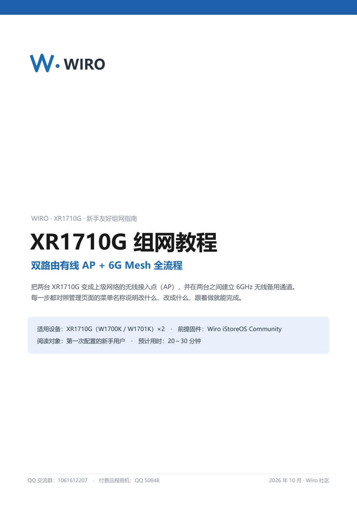
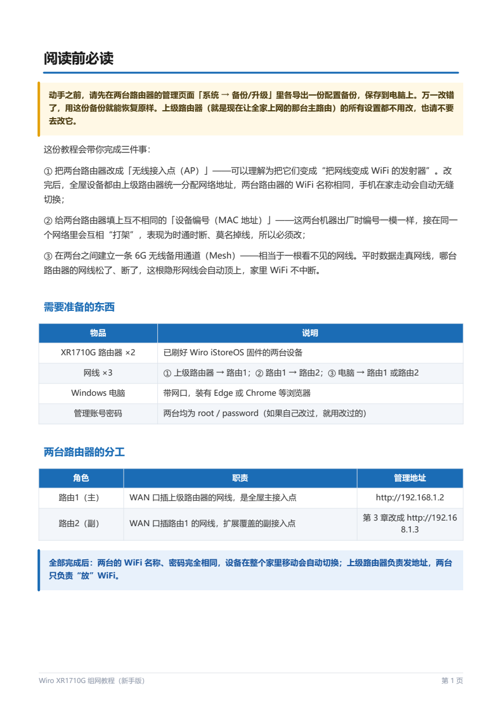
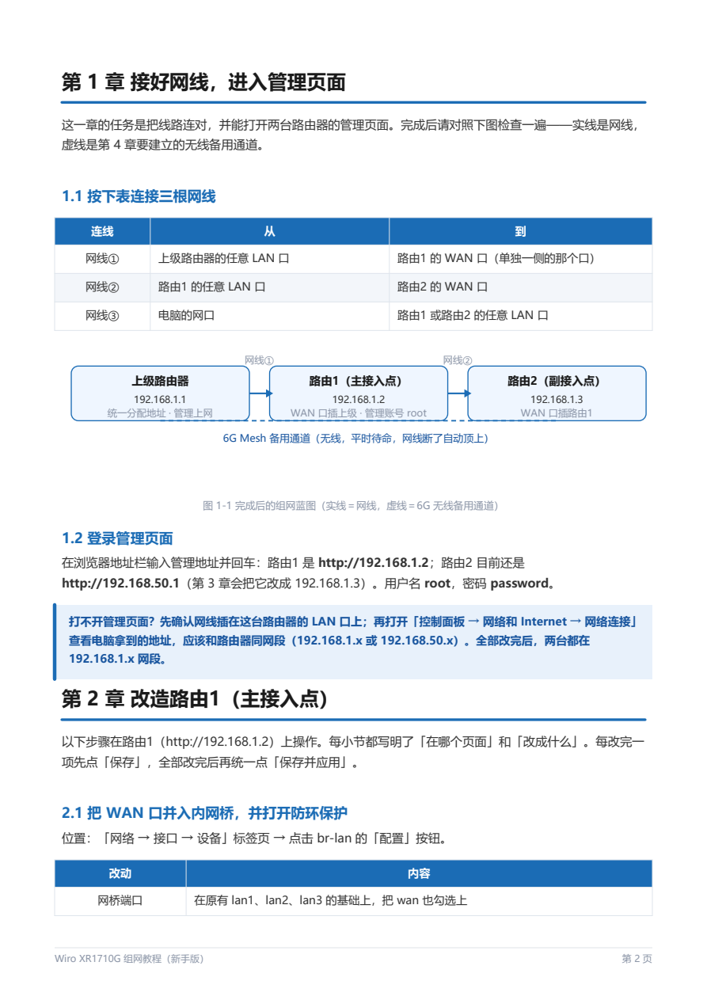
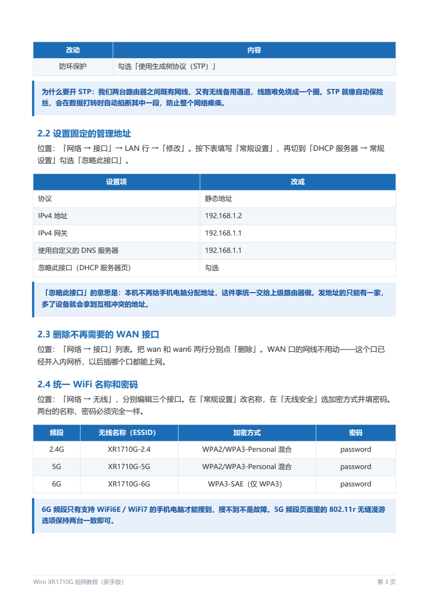
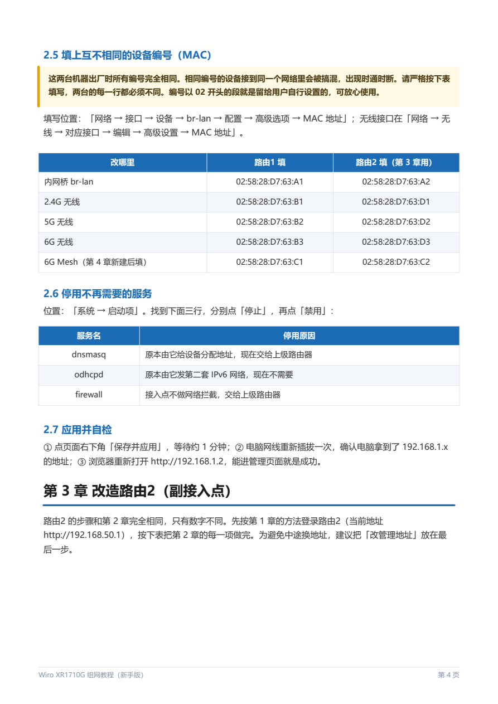
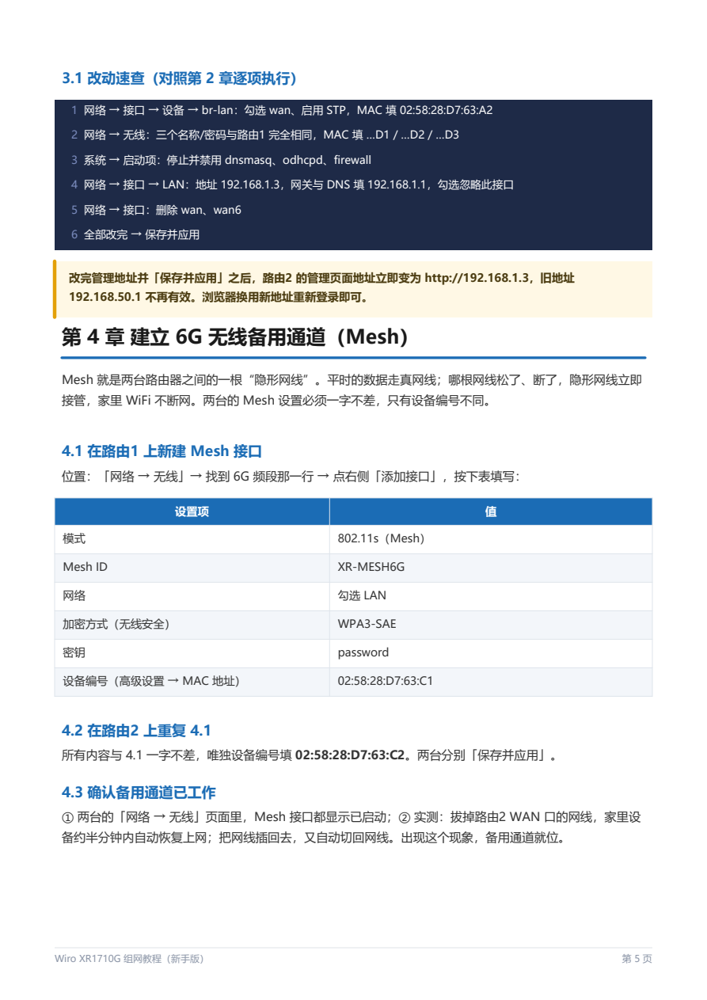
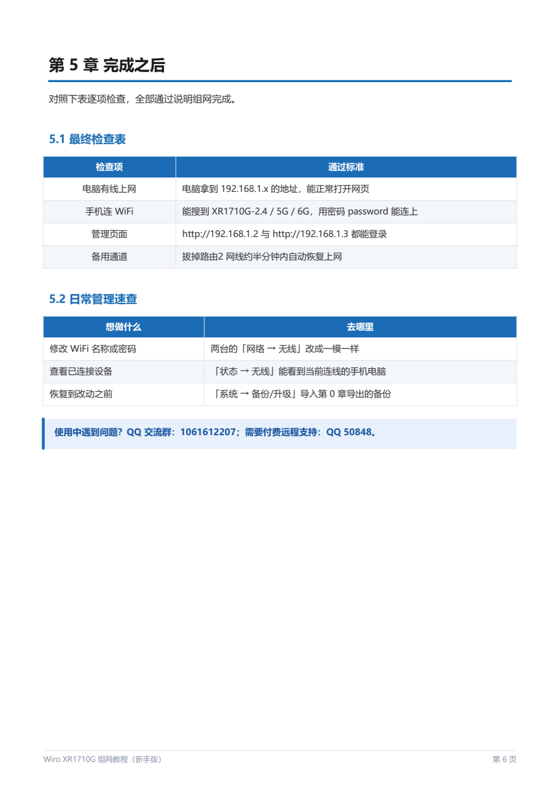

# XR1710G AP组网教程

本页逐页展示原 PDF，教程内容保持原样，覆盖双 AP 与 6GHz Mesh 组网设置。

[返回首页](../../README.md) · [下载原版 PDF](https://github.com/orangeyoo/XR1710G-OpenWrt-iStoreOS-Community/releases/download/v2.02/XR1710G-AP-Networking-Guide-ZH.pdf)

> 注意：示例密码必须修改；示例地址需按实际网络调整；固件相关功能请以实际固件为准。本次仅发布文档，不代表新增实机验证。

## 第 1 页

## 第 2 页

## 第 3 页

## 第 4 页

## 第 5 页

## 第 6 页

## 第 7 页

