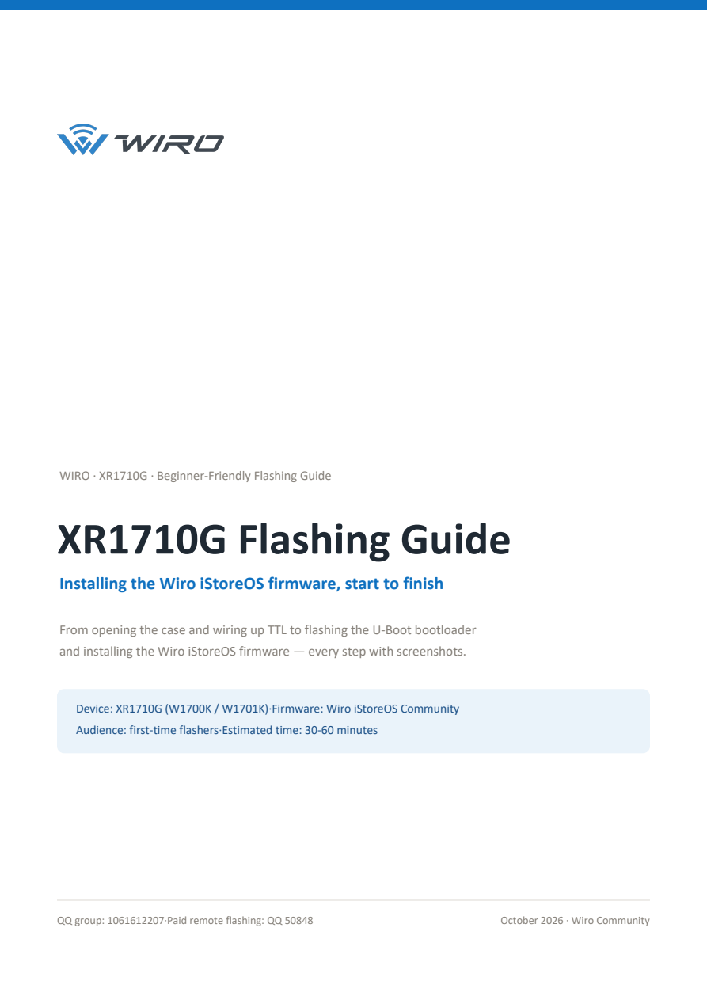
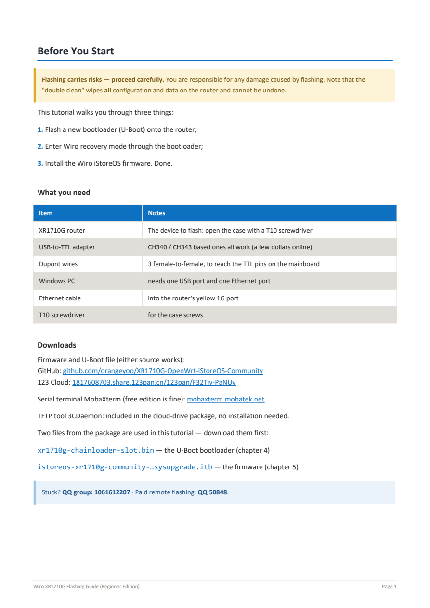
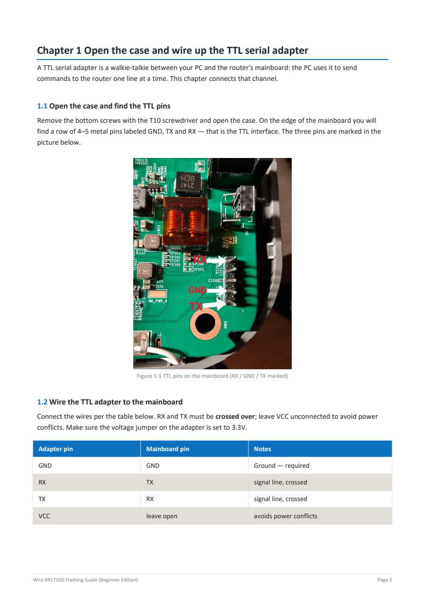
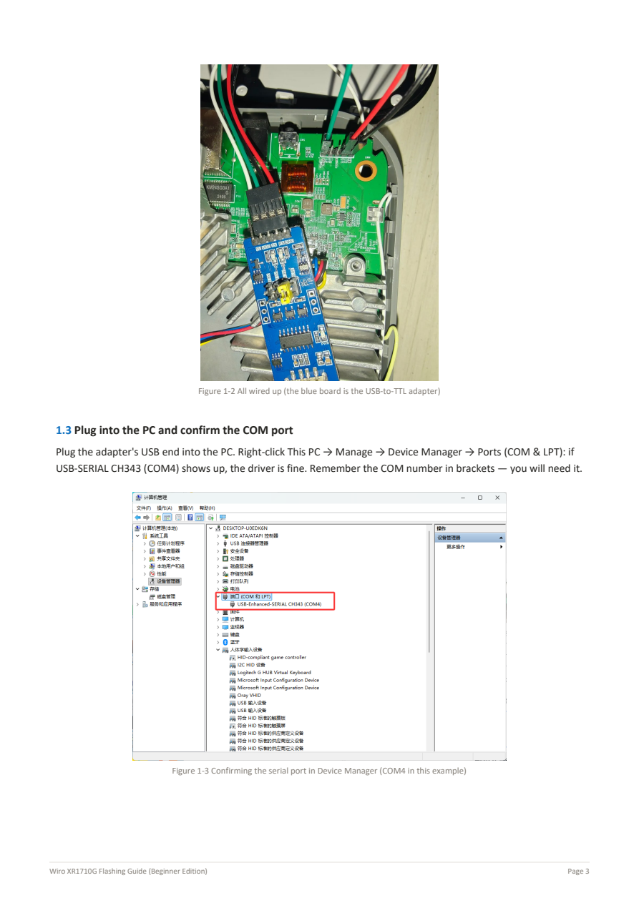
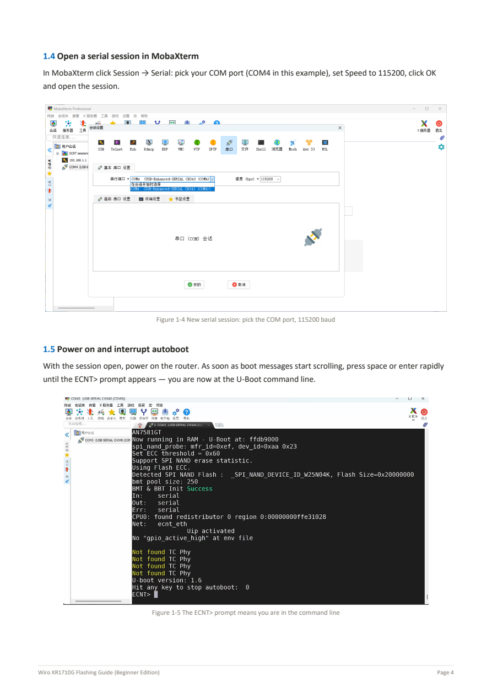
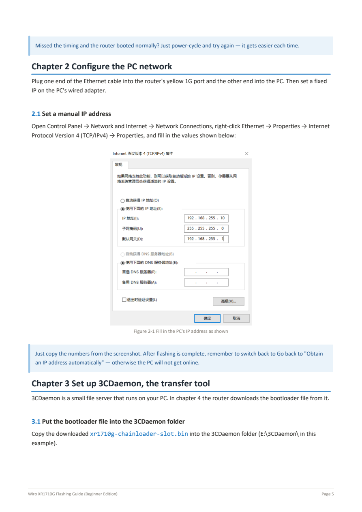
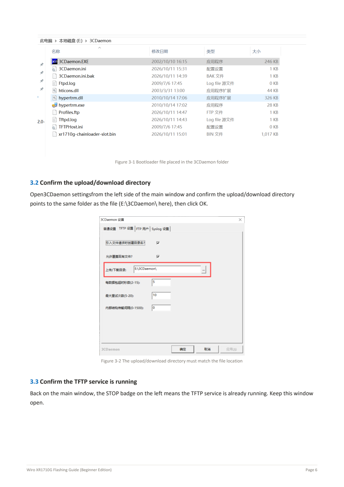
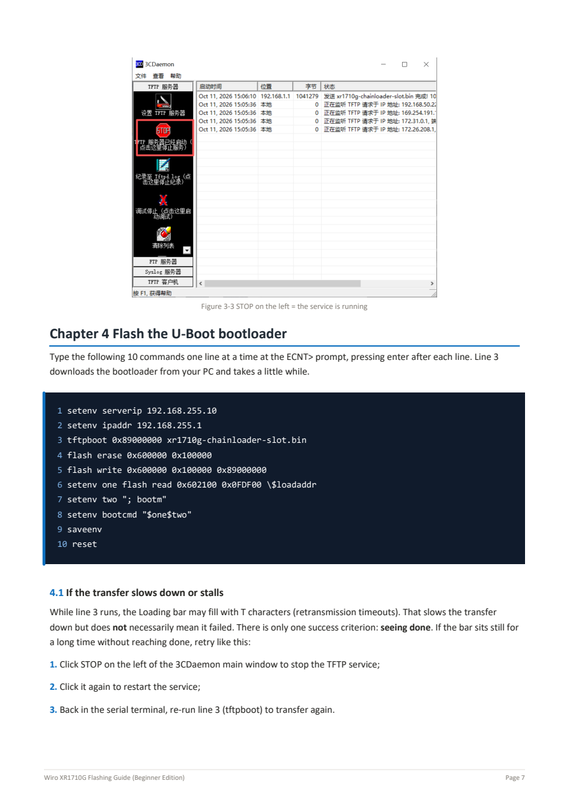
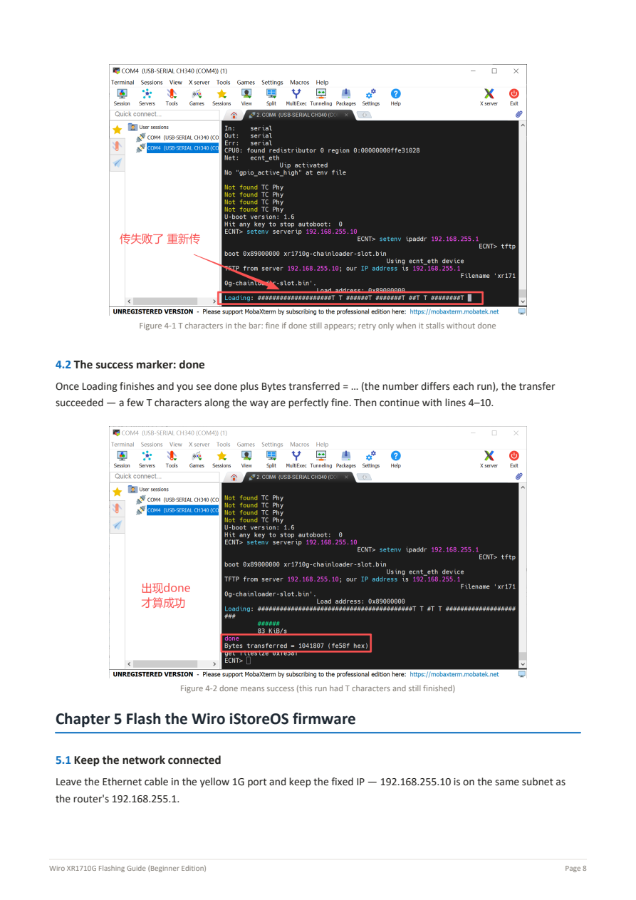
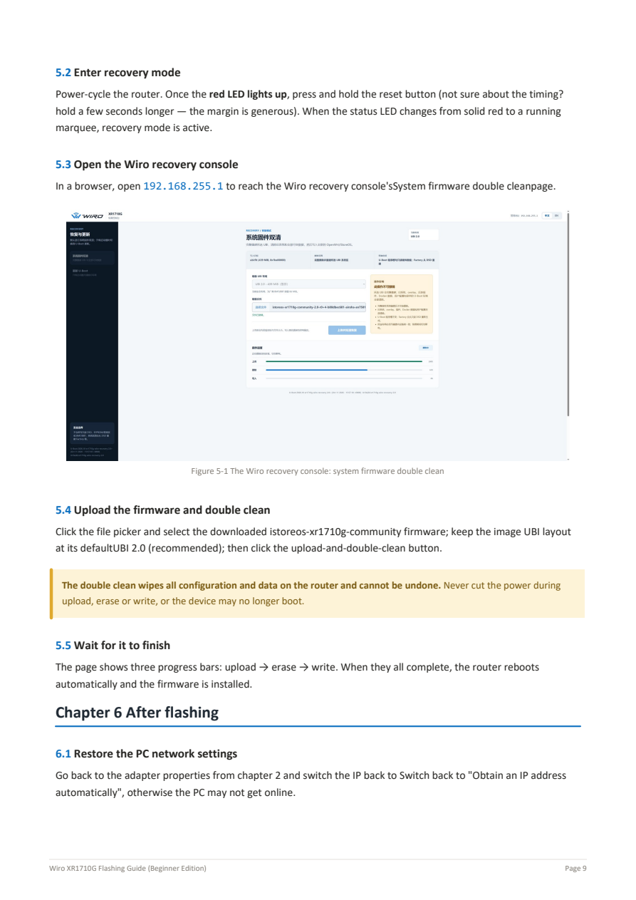

# XR1710G Illustrated Flashing Guide

This page displays the original PDF as page images without relying on GitHub PDF preview. The tutorial is unchanged; version numbers in screenshots are historical. Use the current release for firmware files.

[Home](../../README-EN.md) · [Download original PDF](https://github.com/orangeyoo/XR1710G-OpenWrt-iStoreOS-Community/releases/download/v2.02/XR1710G-Flashing-Guide-EN.pdf) · [Current release](https://github.com/orangeyoo/XR1710G-OpenWrt-iStoreOS-Community/releases/latest) · [中文](XR1710G-Flashing-Guide-ZH.md)

## Page 1

## Page 2

## Page 3

## Page 4

## Page 5

## Page 6

## Page 7

## Page 8

## Page 9

## Page 10

## Page 11

