# XR1710G 图文刷机指南

本页逐页展示原 PDF，无需 GitHub 的 PDF 预览器。教程内容保持原样，截图中的版本号属于编写时版本；固件文件以当前发布页为准。

[返回首页](../../README.md) · [下载原版 PDF](https://raw.githubusercontent.com/orangeyoo/XR1710G-OpenWrt-iStoreOS-Community/source-2.0/docs/tutorials/XR1710G-Flashing-Guide-ZH.pdf) · [当前发布](https://github.com/orangeyoo/XR1710G-OpenWrt-iStoreOS-Community/releases/latest) · [English](XR1710G-Flashing-Guide-EN.md)

## 第 1 页

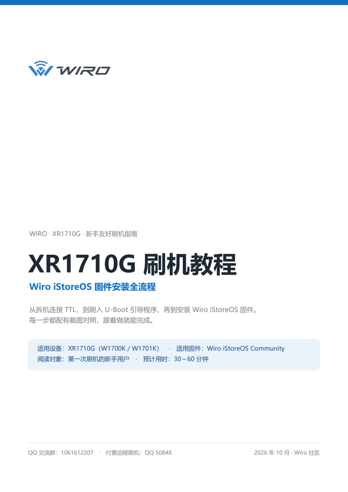

## 第 2 页

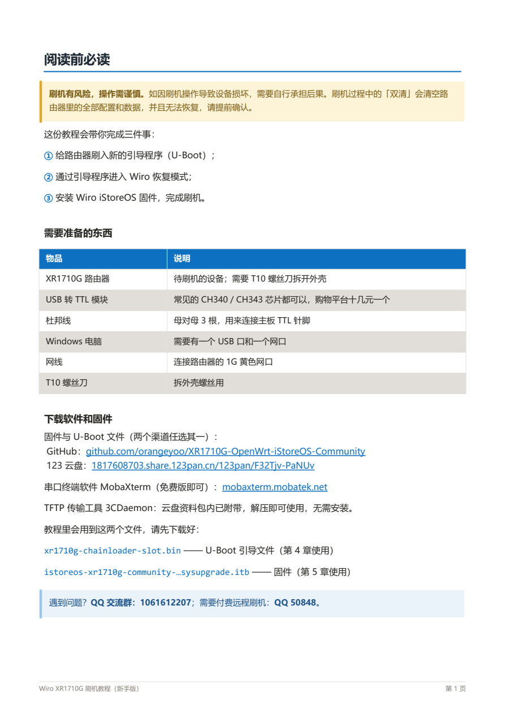

## 第 3 页

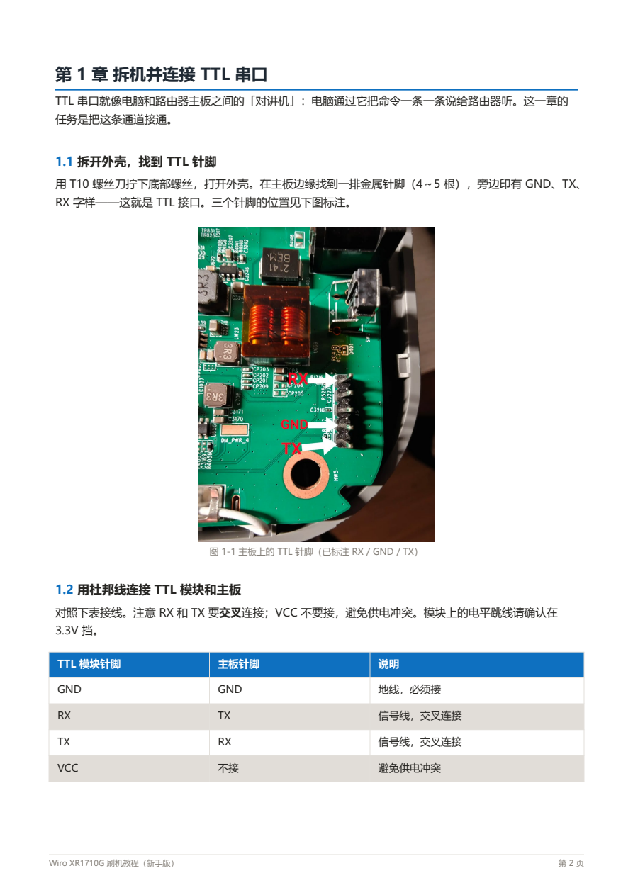

## 第 4 页

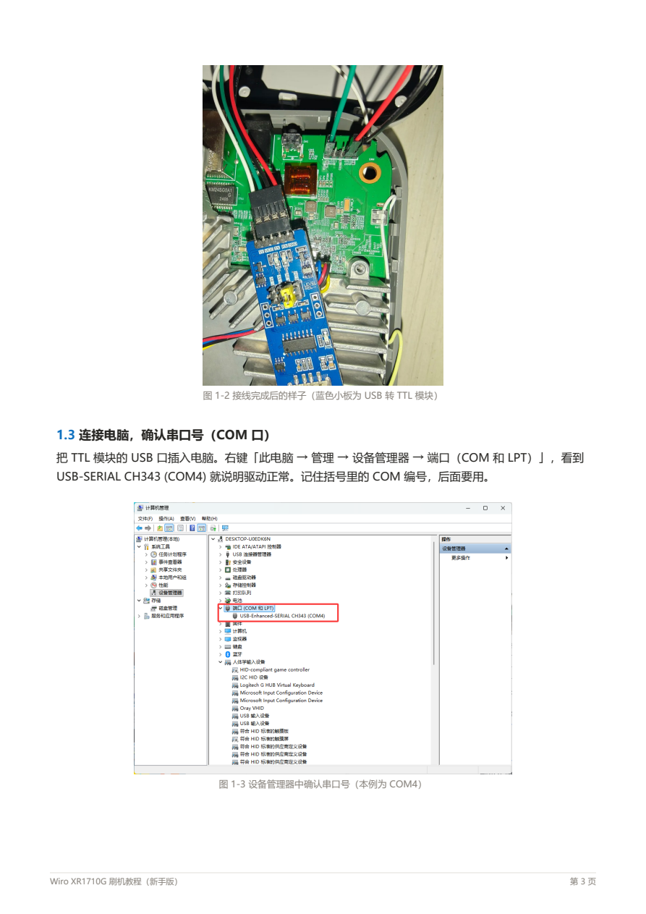

## 第 5 页

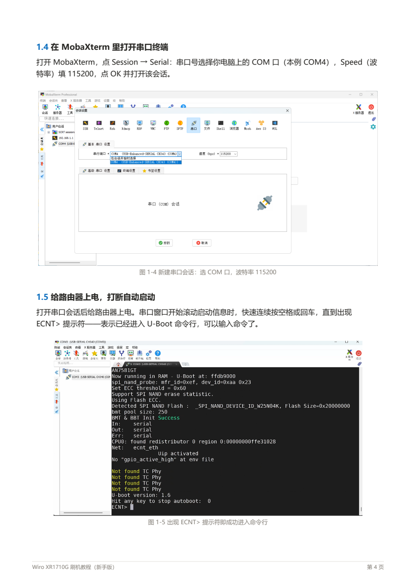

## 第 6 页

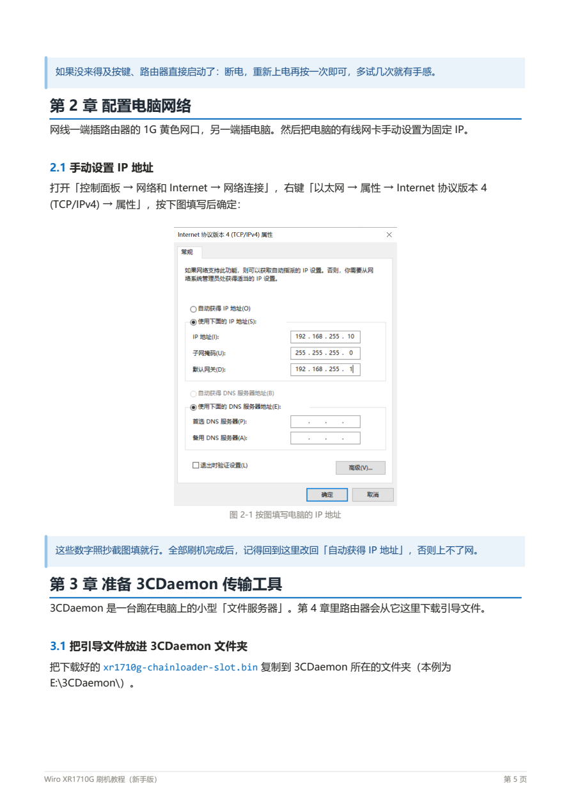

## 第 7 页

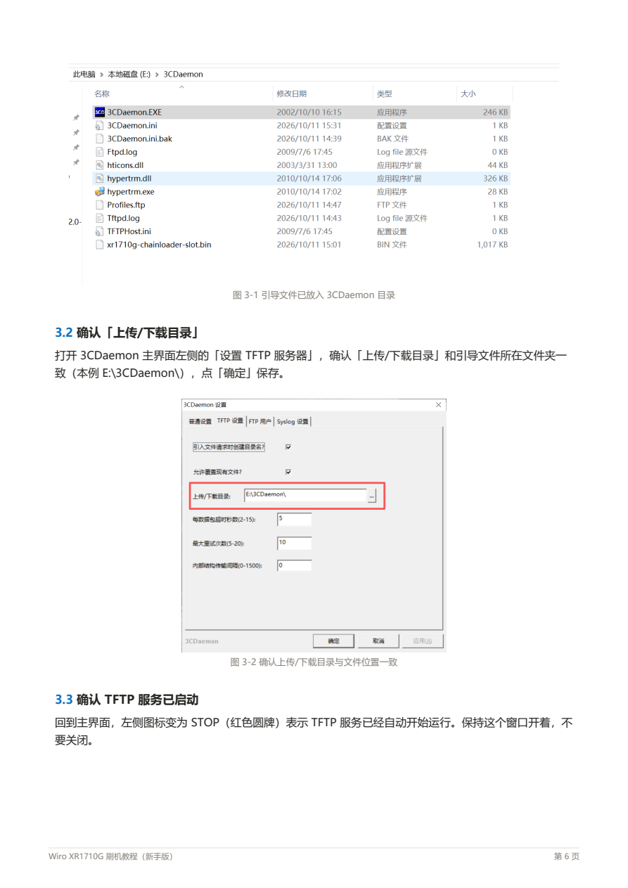

## 第 8 页

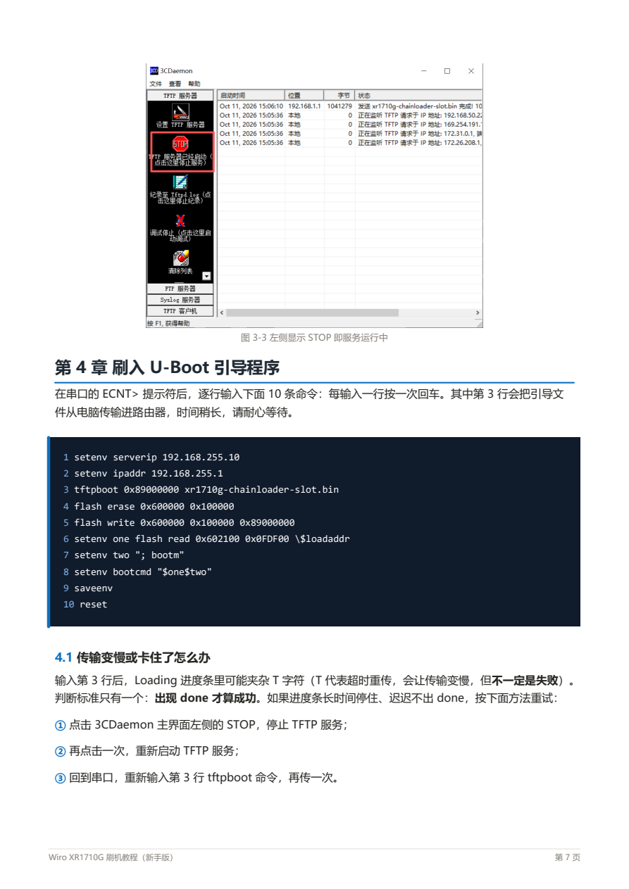

## 第 9 页

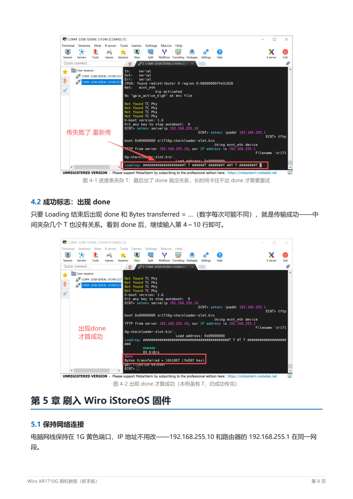

## 第 10 页

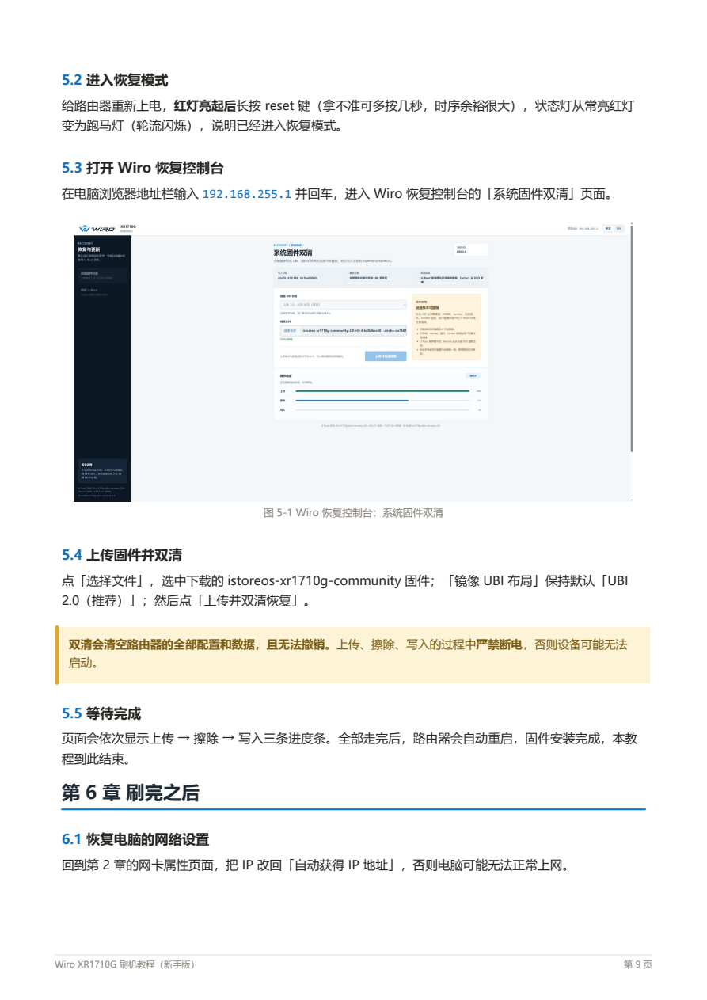

## 第 11 页

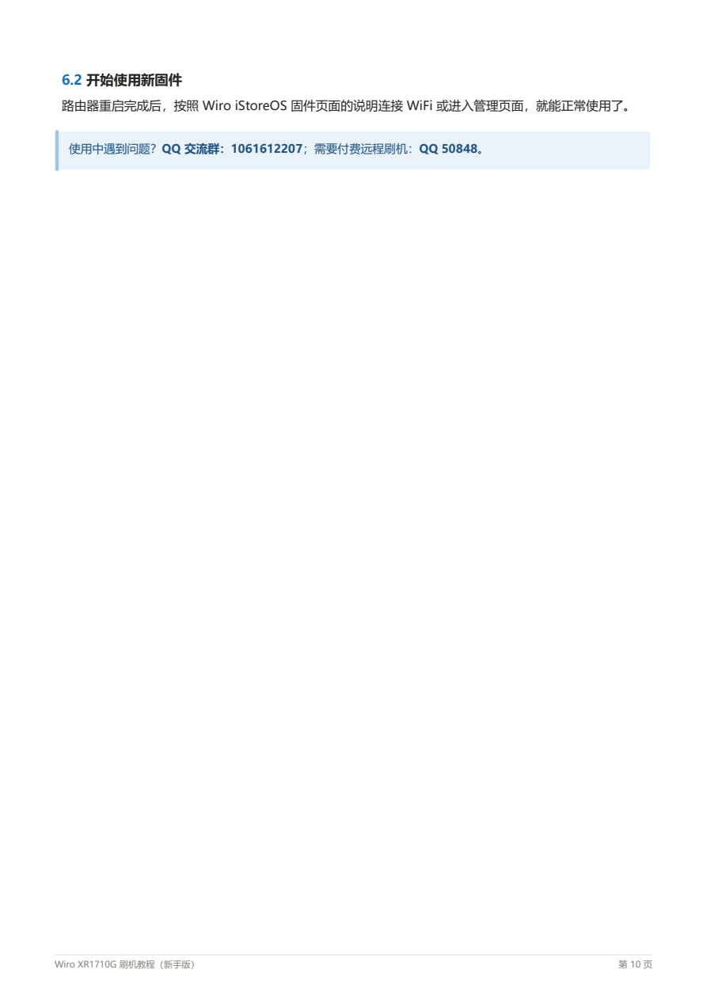
